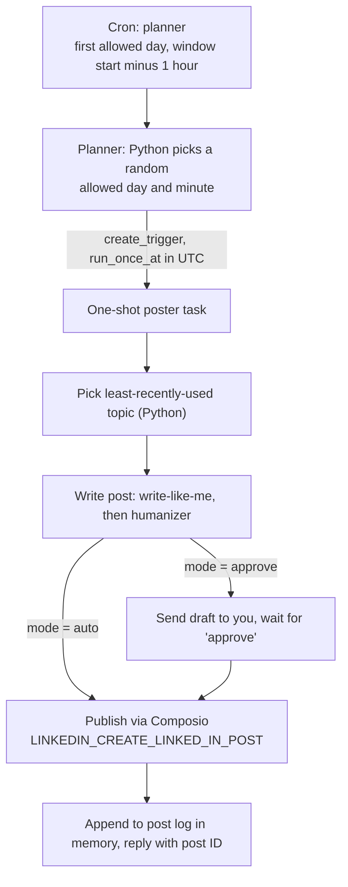

# linkedin-weekly-poster

A Claude skill that sets up automatic weekly LinkedIn posts at random times inside a window you choose. It runs as two layers of scheduled tasks, so the timing is random and the model never picks the numbers.

Say **"set up the LinkedIn weekly poster"** in Claude, and it will ask for your topics and schedule, then install everything.

## How it works

- **Planner.** A recurring cron task. Cron cannot pick a random time, so the planner runs a short Python snippet in bash to choose a random allowed weekday in the coming week and a random minute inside the window. It converts that to UTC and creates a one-shot poster task for that moment.
- **Poster.** The one-shot task. It reads your config from memory, picks the topic that was used longest ago (never last week's), writes the post in your voice, publishes it, logs it, and reports the post ID.

## Requirements

- Claude with scheduled-task tools: `create_trigger`, `list_triggers`, `update_trigger`, `delete_trigger`, `fire_trigger`.
- [Composio](https://composio.dev) with a connected LinkedIn account. In claude.ai, add a custom connector named `composio` with URL `https://connect.composio.dev/mcp`, then connect LinkedIn inside it.
- Session history tools (`list_sessions`, `list_events`), used to learn your voice from past conversations.
- Memory enabled. The config, learned voice rules, and post log live in `/areas/linkedin-poster.md`.
- Optional: the `write-like-me` and `humanizer` skills. Without them, posts use a plain conversational voice.

## Install

1. Add this skill to Claude. Copy this folder to your skills directory, or install it from the repository.
2. Set up Composio and connect LinkedIn, as described above.
3. Optional: set up `write-like-me` so posts match your voice. The skill offers this if it finds no profile.
4. In a Claude conversation, say: **"set up the LinkedIn weekly poster"**.
5. Answer the four questions Claude always asks:
   - **timezone**: your IANA timezone, for example `Asia/Jerusalem`.
   - **language**: English, Hebrew, `alternate`, or `random`.
   - **mode**: `auto` posts on its own. `approve` sends you each draft first and publishes after you reply "approve".
   - **subjects**: 3 to 10 topics, one per line.
   
   Claude then uses defaults for days (Sun–Thu), window (08:00–12:00), and visibility (`PUBLIC`) unless you ask to change them.
6. Claude reads your recent conversations to learn how you write, and shows you the rules it found. Confirm them or correct them.
7. Check the permission mode of the two scheduled tasks. Unattended posting needs **Automatically approve**. If a task is set to **Ask**, switch it in the task settings.

## Changing or pausing

- **Change topics, language, style, or mode:** edit the Config section of `/areas/linkedin-poster.md`. The next run uses the new values.
- **Change days, window, or timezone:** edit the memory file, then ask Claude to update the planner's schedule. Claude will also clear any post already pending for this week.
- **Pause:** ask Claude to disable the planner and delete the pending post.
- **Resume:** ask Claude to re-enable the planner.

## Limits

- LinkedIn posts must be 3,000 characters or fewer. The poster aims for 600 to 1,300 and never exceeds 2,900.
- The LinkedIn API cannot read your profile text, so the voice comes only from `write-like-me`.
- `LINKEDIN_GET_MY_INFO` is rate-limited. Claude resolves your author URN once, during setup.

## License

MIT. See [LICENSE](LICENSE).
